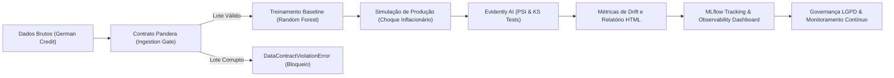
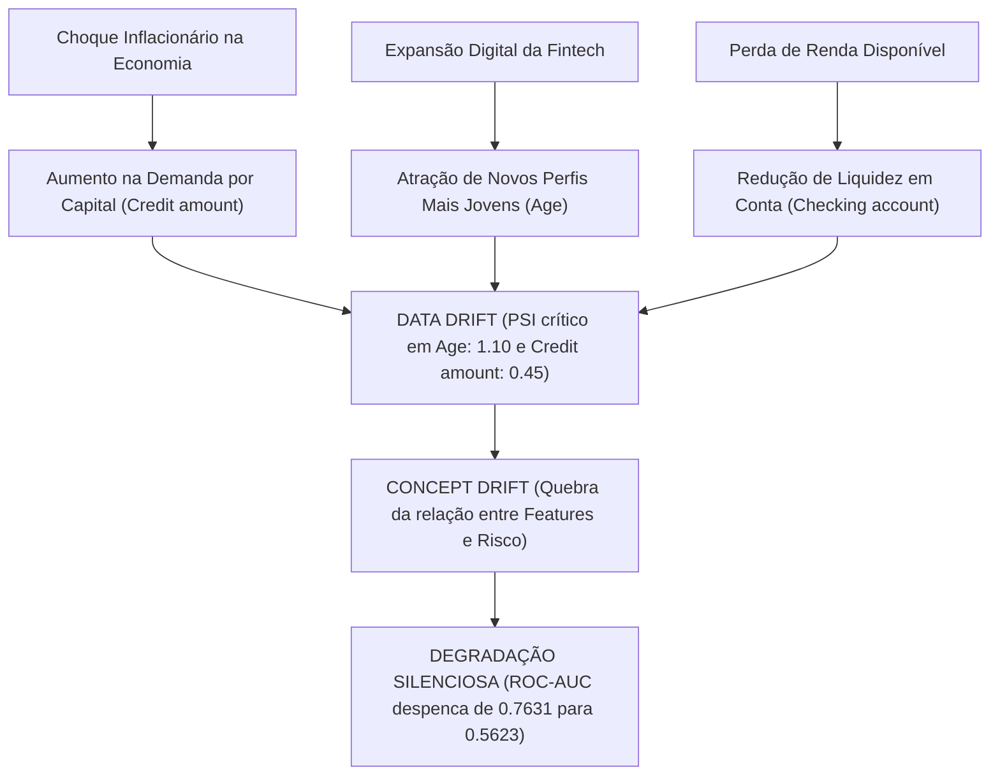

# Tech Challenge — Fase 4: MLOps em Risco de Crédito
### Sustentação, Qualidade de Dados, Detecção de Drift, Observabilidade e Governança

Tech Challenge da Fase 4 da pós-graduação em Machine Learning (FIAP). **Grupo 98.**

- **Repositório GitHub:** [https://github.com/gui3561-ux/grupo-98-tech-challenger-fase4](https://github.com/gui3561-ux/grupo-98-tech-challenger-fase4)
- **Vídeo de Demonstração (Método STAR — ≤ 5 min):** [Link do YouTube](https://youtu.be/SEU_LINK_AQUI) *(substitua pelo link final da gravação do grupo)*

| RM | Integrante | Responsabilidade Principal na Apresentação STAR |
|---|---|---|
| RM371323 | Guilherme Ramos Couceiro | Apresentação e Arquitetura de Sustentação |
| RM372947 | Lucas Ribeiro Pestana | Validação de Contratos de Dados (Pandera) |
| RM373551 | Sávio Aparecido Crispim | Simulação e Detecção Estatística de Drift (Evidently) |
| RM373555 | Wesley Oliveira | Observabilidade e Tracking de Experimentos (MLflow) |
| RM373529 | Cristiano Santos de Oliveira | Governança (LGPD), Análise Causal e Conclusões |

---

## 1. Visão Geral do Projeto

No setor financeiro e em fintechs de concessão de crédito, a estabilidade e a confiabilidade de modelos preditivos em produção são vitais para a saúde da carteira. Mudanças no cenário macroeconômico (inflação, juros, novos hábitos de consumo) frequentemente provocam uma **degradação silenciosa**: o modelo continua respondendo às requisições sem erros de software, mas suas predições tornam-se progressivamente enviesadas ou imprecisas, elevando taxas de inadimplência ou recusando clientes elegíveis.

O objetivo deste projeto é construir a **Camada de Sustentação e Confiabilidade MLOps** para um modelo de *Credit Scoring*, implementando:
1. **Contratos Estritos de Dados (Pandera):** Barreira de qualidade de dados (*Ingestion Gate*) que impede que dados corruptos alimentem o modelo.
2. **Detecção e Diagnóstico de Drift (Evidently AI):** Simulação de choque macroeconômico (Data Drift e Concept Drift) e avaliação estatística via Population Stability Index (PSI) e teste de Kolmogorov-Smirnov (KS).
3. **Observabilidade de Pipelines e Modelos (MLflow):** Rastreamento de ponta a ponta do ciclo de vida, logging estruturado de cada estágio, medição de latência, persistência de artefatos visuais e painel centralizado de métricas operacionais.
4. **Governança e Conformidade com a LGPD:** Enquadramento jurídico nas bases legais aplicáveis (Art. 7º, X e IX), mitigação de viés discriminatório e política de ciclo de vida e retenção de dados.
5. **Análise Causal da Degradação:** Explicação técnica do mecanismo que provocou a perda de acurácia preditiva entre os datasets de referência e produção.



---

## 2. Guia Rápido de Execução Reproduzível

O projeto é gerenciado pelo [`uv`](https://docs.astral.sh/uv/) garantindo reprodutibilidade estrita.

### 2.1. Instalação e Preparação do Ambiente

```bash
# 1. Clonar o repositório
git clone https://github.com/gui3561-ux/grupo-98-tech-challenger-fase4.git
cd grupo-98-tech-challenger-fase4

# 2. Sincronizar o ambiente virtual (instala Pandera, Scikit-Learn, Evidently, MLflow, etc.)
uv sync

# 3. Gerar o dataset de crédito base com target 'Risk' integrado
uv run python -m src.credit.data.make_dataset
```

### 2.2. Execução das Etapas do Tech Challenge

O repositório oferece scripts dedicados para cada entrega avaliada pela banca:

| Etapa | Comando de Execução | Descrição do Entregável |
|---|---|---|
| **Etapa 1** | `uv run python -m src.credit.run_etapa1` | Valida contrato Pandera, treina o baseline e demonstra a interceptação e bloqueio de lote corrupto. |
| **Etapa 2** | `uv run python -m src.credit.run_etapa2` | Simula produção com choque macroeconômico, calcula testes de drift (PSI/KS) e gera relatórios interativos. |
| **Etapa 3** | `uv run python -m src.credit.pipeline` | Orquestra o pipeline unificado de ponta a ponta registrando métricas de latência, saúde e artefatos no MLflow. |
| **MLflow UI**| `uv run mlflow ui` | Abre a interface de visualização do MLflow em `http://127.0.0.1:5000` para auditoria dos experimentos e artefatos. |
| **Testes** | `uv run pytest tests/` | Executa a suíte completa de testes automatizados unitários e de integração. |

---

## 3. Detalhamento das Etapas de Engenharia

### 3.1. Etapa 1 — Validação de Dados e Contratos (Data Contracts)

A validação pré-ingestão garante que inconsistências estruturais não alcancem os modelos de aprendizado.
Implementada em `src/credit/data/contracts.py` através do **Pandera**, a validação aplica regras estritas sobre o schema do *German Credit Data*:

- **Idade Válida:** `Age >= 18` (apenas indivíduos civilmente capazes podem contrair crédito).
- **Sem Valores Nulos:** Nenhuma coluna fundamental aceita valores ausentes (`nullable=False`), e dados categóricos nulos devem vir previamente categorizados de forma determinística (`unknown`).
- **Sem Duplicatas:** O lote é verificado contra duplicações acidentais de registros.
- **Categorias Fechadas:** Variáveis como `Sex` (`male`, `female`), `Housing` (`own`, `rent`, `free`), `Saving accounts` e `Checking account` possuem domínios permitidos estritos.
- **Limites e Tipagem:** `Credit amount` e `Duration` devem ser estritamente positivos.

#### Demonstração de Bloqueio de Lote Corrupto
Para evidenciar a barreira de dados, `src/credit/run_etapa1.py` injeta um lote propositalmente corrompido com idades menores de 18 anos, categorias inexistentes e nulos ilegais. O pipeline intercepta a anomalia imediatamente, lançando `DataContractViolationError` e abortando o processamento antes do cálculo de qualquer inferência.

### 3.2. Etapa 2 — Simulação e Detecção Estatística de Drift

Para diagnosticar a degradação silenciosa provocada por transformações socioeconômicas, o script `src/credit/drift/simulate_drift.py` simula o ambiente de produção sob estresse:
1. **Choque Inflacionário:** Multiplicação de `Credit amount` em 1.5x e adição de ruído estocástico, simulando maior necessidade de capital nominal pelos tomadores.
2. **Rejuvenescimento do Perfil:** Deslocamento da média de `Age` para perfis mais jovens (entrantes no mercado digital de fintechs com histórico creditício escasso).
3. **Liquidez Comprimida:** Degradação das faixas de saldo em `Checking account`, elevando proporções de clientes com liquidez classificada em `little`.

#### Diagnóstico Estatístico com Evidently AI
Executado por `src/credit/run_etapa2.py`:
- **Population Stability Index (PSI):** Quantifica o desvio entre as distribuições empíricas de referência e produção. Valores de $\text{PSI} \ge 0.25$ indicam instabilidade severa.
  - `Age`: $\text{PSI} \approx 1.10$ (**Drift Crítico**)
  - `Credit amount`: $\text{PSI} \approx 0.45$ (**Drift Crítico**)
- **Teste Kolmogorov-Smirnov (KS):** Avalia a hipótese nula de igualdade das distribuições contínuas ($p\text{-valor} < 0.05$ evidencia mudança significativa).
- **Artefatos Gerados:**
  - `reports/drift_report.html`: Relatório interativo do Evidently AI detalhando distribuições marginais e testes bivariados.
  - `reports/drift_stats.csv`: Matriz estatística consolidada com métricas de drift por feature.
  - `reports/drift_summary.md`: Diagnóstico executivo resumido.

### 3.3. Etapa 3 — Observabilidade de Pipelines e Modelos (MLflow)

Implementada em `src/credit/observability.py` e integrada em `src/credit/pipeline.py`:
- **Tracking Server:** Configurado sobre backend SQLite seguro (`sqlite:///mlflow.db`) e diretório `./mlruns`.
- **Logs Estruturados:** Todas as execuções gravam logs padronizados com timestamps, níveis de severidade e latência por etapa no arquivo operacional `reports/pipeline_execution.log`.
- **Métricas de Saúde Registradas no MLflow:**
  - `latency_validation_seconds`, `latency_training_seconds`, `latency_drift_seconds` e `latency_total_seconds`.
  - Contagem de registros processados: `rows_reference` e `rows_production`.
  - Contagem de alertas críticos: `drift_critical_alerts_count` (contagem de variáveis com $\text{PSI} \ge 0.25$).
  - Métricas de desempenho do modelo: `model_roc_auc`, `model_accuracy` e `model_f1_bad_risk`.
- **Persistência de Artefatos:** Cada run anexa automaticamente o modelo serializado (`models/credit_baseline.joblib`), as métricas JSON, o log de execução e os relatórios interativos HTML e CSV do Evidently.

---

## 4. Governança de Dados e Conformidade com a LGPD

O tratamento de dados pessoais no modelo de Credit Scoring do Grupo 98 foi concebido sob os princípios de *Privacy by Design* e *Privacy by Default*, atendendo integralmente à Lei Geral de Proteção de Dados Pessoais (**Lei nº 13.709/2018 - LGPD**).

### 4.1. Bases Legais Aplicáveis

A operação do pipeline de concessão de crédito se fundamenta nas seguintes hipóteses legais da LGPD:

1. **Proteção do Crédito (Artigo 7º, inciso X, LGPD):**
   - É a base legal mestra para modelos de Credit Scoring no ordenamento jurídico brasileiro. Permite o tratamento de dados cadastrais e financeiros para subsidiar a análise de risco de inadimplência, garantindo a solidez do sistema financeiro nacional e a precificação justa de taxas de juros.
2. **Legítimo Interesse do Controlador (Artigo 7º, inciso IX, LGPD):**
   - Aplica-se às atividades de monitoramento contínuo de estabilidade, detecção de anomalias, observabilidade de pipelines e prevenção de fraudes, sempre assegurando que as expectativas legítimas dos titulares sejam respeitadas por meio de teste de proporcionalidade (*LIA - Legitimate Interests Assessment*).

### 4.2. Mapeamento de PII, Dados Sensíveis e Mitigação de Vieses

O *German Credit Dataset* contém variáveis que demandam avaliação estrita quanto ao potencial discriminatório:

| Variável | Classificação LGPD | Risco de Viés / Mitigação Adotada |
|---|---|---|
| **`Sex` (Gênero)** | Dado Pessoal (indireto sensível) | **Mitigação:** De acordo com o Art. 6º, IX (não discriminação), o gênero não pode determinar desfechos adversos de crédito de forma injustificada. O pipeline prevê auditorias periódicas de *Fairness* (*Disparate Impact Ratio* e paridade demográfica). Se detectado impacto desproporcional, o atributo deve sofrer desponderação ou remoção como feature ativa. |
| **`Age` (Idade)** | Dado Pessoal | **Mitigação:** Utilizado unicamente para validação de maioridade civil (Art. 5º do Código Civil) e calibração de estabilidade financeira. É monitorado pelo teste PSI para garantir que novas faixas etárias não sejam sumariamente penalizadas pela ausência de histórico pregresso. |
| **`Credit amount`, `Duration`, `Job`** | Dados Transacionais / Cadastrais | **Mitigação:** Atributos estritamente pertinentes e necessários à finalidade de concessão (princípios da necessidade e adequação, Art. 6º, I e III). |

> [!IMPORTANT]
> **Proibição de Discriminação Ilícita (Artigo 6º, inciso IX, LGPD):**
> O tratamento de dados pessoais para crédito jamais pode ser utilizado para finalidades discriminatórias ilícitas ou abusivas em razão de raça, orientação sexual, gênero ou convicções pessoais.

### 4.3. Direitos dos Titulares e Revisão de Decisões Automatizadas

Em cumprimento ao **Artigo 20 da LGPD**:
- O titular tem o direito de solicitar a **revisão de decisões tomadas unicamente com base em tratamento automatizado** de dados pessoais que afetem seus interesses, incluindo decisões destinadas a definir o seu perfil de crédito (*credit score*).
- O controlador deve fornecer, sempre que solicitado, informações claras e adequadas a respeito dos critérios e dos procedimentos utilizados para a decisão automatizada (explicabilidade do modelo via SHAP/Feature Importance), observados os segredos comercial e industrial.

### 4.4. Ciclo de Vida, Segurança e Política de Retenção e Descarte

- **Segurança da Informação (Art. 46, LGPD):** O armazenamento dos dados de crédito adota pseudonimização de identificadores de clientes e criptografia em repouso e trânsito.
- **Término do Tratamento e Retenção (Art. 15 e 16, LGPD):**
  - Dados de propostas de crédito recusadas são retidos pelo prazo prescricional para resposta a eventuais contestações judiciais ou administrativas (tipicamente até 5 anos, em conformidade com o Código de Defesa do Consumidor e normas do BACEN).
  - Após o decurso do prazo regulatório de guarda, os dados são descartados de maneira segura ou submetidos a anonimização irreversível para uso exclusivo em pesquisas estatísticas internas.

---

## 5. Análise Causal da Degradação Silenciosa

A investigação forense da perda de performance entre o ambiente de referência (treino) e o ambiente de produção revelou um nexo causal bem delimitado entre fatores macroeconômicos, deslocamento distribucional e colapso das fronteiras de classificação.



### 5.1. Mecanismo Macroeconômico e Comportamental

1. **Pressão Inflacionária e Custo de Vida:**
   Com a elevação da inflação acumulada, o montante nominal solicitado nos empréstimos aumentou sensivelmente. O que anteriormente era considerado um empréstimo de valor atípico ou alto risco no período de referência tornou-se o valor padrão solicitado para necessidades básicas em produção.
2. **Reconfiguração Etária da Base de Clientes:**
   A estratégia de aquisição digital atraiu tomadores substancialmente mais jovens (`Age` médio menor). No entanto, o modelo treinado na distribuição antiga havia aprendido que tomadores jovens possuíam, historicamente, um risco ligeiramente superior devido ao menor tempo de relacionamento bancário estável.
3. **Contração de Liquidez Imediata:**
   A proporção de clientes operando na faixa `little` de `Checking account` cresceu em virtude da volatilidade econômica e menor poupança preventiva.

### 5.2. O Fenômeno Estatístico: De Data Drift a Concept Drift

- **Data Drift (Mudança em $P(X)$):**
  A distribuição conjunta dos atributos de entrada sofreu severa perturbação. O teste PSI acusou instabilidade crítica em `Age` ($\text{PSI} \approx 1.10$) e `Credit amount` ($\text{PSI} \approx 0.45$), enquanto o teste de Kolmogorov-Smirnov rejeitou a hipótese de estabilidade ($p\text{-valor} < 10^{-4}$).
- **Concept Drift (Mudança em $P(Y \mid X)$):**
  Como as variáveis preditoras mudaram de escala e contexto socioeconômico, a correlação entre as features e o verdadeiro comportamento de adimplência mudou. Um empréstimo de valor elevado já não indicava necessariamente uma compra suntuária arriscada, mas sim a reposição inflacionária ordinária.
- **Impacto no Desempenho do Modelo:**
  O classificador baseline (*Random Forest*), cujas regras de partição e limites de decisão foram calibrados sobre o espaço de treino original, perdeu completamente a calibração de probabilidades:
  - **ROC-AUC em Holdout (Referência):** $0.7631$ (modelo com bom poder discriminativo).
  - **ROC-AUC em Produção:** $0.5623$ (modelo degradado para próximo de um classificador aleatório, $\Delta = -0.2008$).
  - **Acurácia Global:** Sofreu queda de $72.57\%$ para $64.67\%$.

### 5.3. Ações Prescritivas de Sustentação MLOps

Diante da detecção tempestiva provida pela camada de observabilidade, a esteira de MLOps deve disparar:
1. **Acionamento de Alerta Operacional:** O orquestrador reporta a violação do limiar de segurança de drift ao time de risco.
2. **Retreino com Ponderação Temporal:** Incorporação do lote de produção mais recente à janela de treinamento, atribuindo pesos de decaimento exponencial aos dados históricos desatualizados.
3. **Engenharia de Features Resilientes:** Criação de variáveis deflacionadas (ex.: razão entre valor solicitado e renda declarada, em vez de valor nominal absoluto).

---

## 6. Roteiro Oficial do Vídeo (Método STAR — 5 Minutos)

Este roteiro foi elaborado para que os integrantes do **Grupo 98** gravem a apresentação do Tech Challenge de forma concisa, técnica e alinhada à matriz de avaliação da FIAP.

- **Tempo Máximo Estrito:** 5 minutos.
- **Divisão por Bloco STAR:**

```mermaid
timeline
    title Estrutura da Apresentação (Método STAR)
    00:00 - 01:00 : Situation (Contexto da Fintech, Risco de Crédito e Degradação Silenciosa)
    01:00 - 02:00 : Task (Requisitos Técnicos: Contratos Pandera, Detecção de Drift e LGPD)
    02:00 - 03:30 : Action (Demonstração Prática: Scripts, Barreira de Dados e MLflow)
    03:30 - 05:00 : Result (Análise de Relatórios Evidently, Causalidade e Conclusões)
```

### Roteiro Detalhado de Gravação

#### [00:00 - 01:00] Bloco 1: Situation (Situação)
- **Apresentador Sugerido:** Guilherme Couceiro / Cristiano Santos
- **Tela a Compartilhar:** Slide inicial com o título do projeto, identificação do Grupo 98 e a arquitetura geral de MLOps.
- **Fala:**
  > *"Olá, professores e avaliadores! Somos o Grupo 98 do Tech Challenge da Fase 4. Nosso desafio aborda um problema crítico do mundo real: a sustentação de modelos de Credit Scoring em produção. Em fintechs de crédito, alterações macroeconômicas silenciosas — como surtos inflacionários e entrada de novos perfis digitais — degradam a performance do modelo sem que o sistema gere qualquer erro de código. Uma instituição que opera cega a essas variações passa a conceder crédito a clientes com perfil de inadimplência ou a negar crédito a bons pagadores, gerando prejuízos milionários. Construímos a camada completa de sustentação e confiabilidade para interceptar essas anomalias."*

#### [01:00 - 02:00] Bloco 2: Task (Tarefa / Requisitos Técnicos)
- **Apresentador Sugerido:** Lucas Pestana
- **Tela a Compartilhar:** Tabela de entregáveis das 4 Etapas no README do repositório.
- **Fala:**
  > *"Nossa missão técnica no Tech Challenge foi dividida em quatro pilares fundamentais: primeiro, construir uma barreira estrita de qualidade de dados com Pandera para assegurar que 'lixo não entre no modelo'; segundo, simular um ambiente realista de produção sob estresse macroeconômico e implementar testes estatísticos rigorosos de drift populacional via Evidently AI; terceiro, construir a infraestrutura de observabilidade e tracking de métricas operacionais com MLflow; e quarto, fundamentar juridicamente as operações sob as regras da LGPD e diagnosticar o nexo causal da perda de acurácia."*

#### [02:00 - 03:30] Bloco 3: Action (Ação e Demonstração Prática)
- **Apresentador Sugerido:** Sávio Crispim / Wesley Oliveira
- **Tela a Compartilhar:** Terminal executando os scripts e visualizando o MLflow UI.
- **Ação 1 (Barreira Pandera):**
  - Executa: `uv run python -m src.credit.run_etapa1`
  - Fala: *"Aqui demonstramos a Etapa 1. O script valida o contrato Pandera e em seguida simula a chegada de um lote corrupto com idades abaixo de 18 anos e categorias nulas. Observem que o Ingestion Gate intercepta imediatamente e aborta com DataContractViolationError, protegendo a esteira."*
- **Ação 2 (Simulação de Drift e Orquestrador):**
  - Executa: `uv run python -m src.credit.pipeline`
  - Fala: *"Agora executamos o pipeline unificado de ponta a ponta. Ele valida os dados, treina o baseline, injeta o choque inflacionário na base de produção, calcula os testes estatísticos e registra tudo no MLflow dentro de uma única run rastreável."*
- **Ação 3 (Observabilidade no MLflow):**
  - Mostra a interface web do MLflow (`http://127.0.0.1:5000`):
  - Fala: *"No MLflow, temos a visão completa da saúde da esteira: latência de cada etapa em milissegundos, total de registros, parâmetros do modelo e o número de alertas críticos de drift. Além disso, todos os artefatos estão salvos na run, incluindo o modelo binário e o relatório interativo de drift."*

#### [03:30 - 05:00] Bloco 4: Result (Resultados, Causalidade e Governança)
- **Apresentador Sugerido:** Cristiano Santos / Guilherme Couceiro
- **Tela a Compartilhar:** O relatório `reports/drift_report.html` aberto no navegador e a seção de Governança do README.
- **Fala:**
  > *"Como resultado, no relatório do Evidently AI comprovamos que as features Age e Credit amount sofreram Data Drift severo, com PSI ultrapassando 1.10 e 0.45, muito acima da margem crítica de 0.25. Na análise causal, explicamos que a inflação expandiu o ticket médio de crédito e atraiu tomadores jovens, fazendo o ROC-AUC do modelo despencar de 0.7631 para 0.5623 — caracterizando o Concept Drift e a perda de poder preditivo.*
  > 
  > *Por fim, na dimensão de Governança e LGPD, formalizamos a concessão de crédito sob o Artigo 7º, inciso X (Proteção ao Crédito) e Legítimo Interesse (inciso IX), estabelecendo diretrizes de mitigação de viés discriminatório em gênero e idade, e garantindo ao titular o direito de revisão de decisões automatizadas pelo Artigo 20. Assim, entregamos uma solução pronta, robusta e aderente às melhores práticas de engenharia de IA e MLOps."*

---

## 7. Estrutura de Diretórios da Fase 4

```
grupo-98-tech-challenger-fase4/
├── data/
│   ├── raw/                       <- Dados brutos (German Credit original e com target Risk)
│   ├── reference/                 <- Dataset de treino/baseline (700 registros limpos)
│   └── production/                <- Datasets de produção (com drift injetado)
├── models/
│   ├── credit_baseline.joblib     <- Modelo Random Forest serializado
│   └── credit_baseline_metrics.json <- Hiperparâmetros e métricas de validação
├── reports/
│   ├── drift_report.html          <- Relatório interativo do Evidently AI
│   ├── drift_stats.csv            <- Estatísticas de PSI e p-valores do teste KS por feature
│   ├── drift_summary.md           <- Sumário executivo da análise de drift
│   └── pipeline_execution.log     <- Log estruturado operacional do pipeline
├── src/
│   └── credit/
│       ├── data/
│       │   ├── contracts.py       <- Esquema e regras estritas do Pandera
│       │   ├── make_dataset.py    <- Download e pareamento de target do German Credit
│       │   └── split_dataset.py   <- Divisão em referência (70%) e produção (30%)
│       ├── model/
│       │   ├── baseline.py        <- Treinamento, pipeline Scikit-Learn e avaliação
│       │   └── evaluate_production.py <- Avaliação de desempenho sobre lote de produção
│       ├── drift/
│       │   ├── simulate_drift.py  <- Injeção de choques de inflação e deslocamento etário
│       │   └── detect_drift.py    <- Execução de testes estatísticos com Evidently AI
│       ├── observability.py       <- Configuração de logging e integração com MLflow
│       ├── pipeline.py            <- Orquestrador unificado de ponta a ponta
│       ├── run_etapa1.py          <- Script executável de validação de contratos e bloqueio
│       └── run_etapa2.py          <- Script executável de simulação e detecção de drift
├── tests/                         <- Suíte de testes automatizados unitários e de integração
├── pyproject.toml                 <- Especificação de dependências e ferramentas (uv)
└── README.md                      <- Documentação oficial consolidada do projeto
```

---

## 8. Apêndice: Fase 3 (Legado — Previsão PETR4.SA LSTM)

> [!NOTE]
> Esta seção preserva integralmente a documentação da **Fase 3** para fins de histórico e rastreabilidade acadêmica. O código da Fase 3 reside em `src/api/` e `src/model/` e pode ser executado com o extra opcional `legacy`.

### Instalação das Dependências da Fase 3
```bash
uv sync --extra legacy
```

### Execução da API e Docker (Fase 3)
```bash
# Execução local da API
uv run uvicorn src.api.main:app --reload --port 8000

# Execução via Docker Compose
docker compose up --build
```
- **Endpoints:**
  - `GET /health`: Diagnóstico de integridade do serviço.
  - `GET /ready`: Validação de prontidão do modelo e scaler serializados.
  - `GET /metrics`: Métricas no padrão Prometheus (latência e uso de memória).
  - `POST /predict`: Previsão do fechamento de D+1 de PETR4.SA para janela de 60 pregões.
  - `GET /docs`: Documentação OpenAPI/Swagger interativa.
